# Tally

**A native iOS 26 personal-finance app where the AI runs on the phone.** Ask "how much did I spend on food in September vs August?" and Apple's on-device Foundation Models answers by calling typed tools over your own data. It also categorises transactions, and nothing leaves the device.

[](https://github.com/OwaisMunawar/tally/actions/workflows/ci.yml)


[](LICENSE)

<p align="center">
  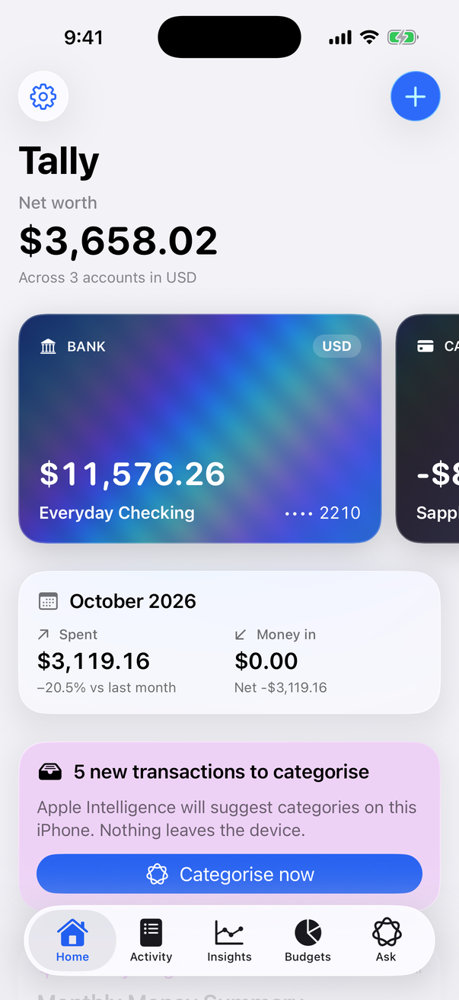
  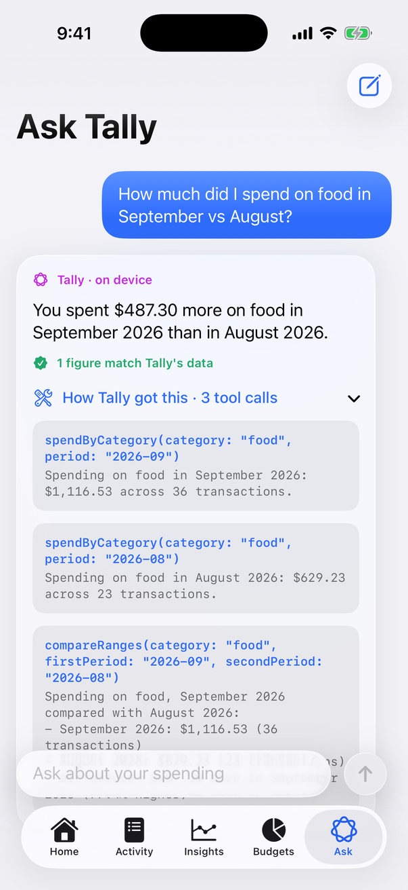
  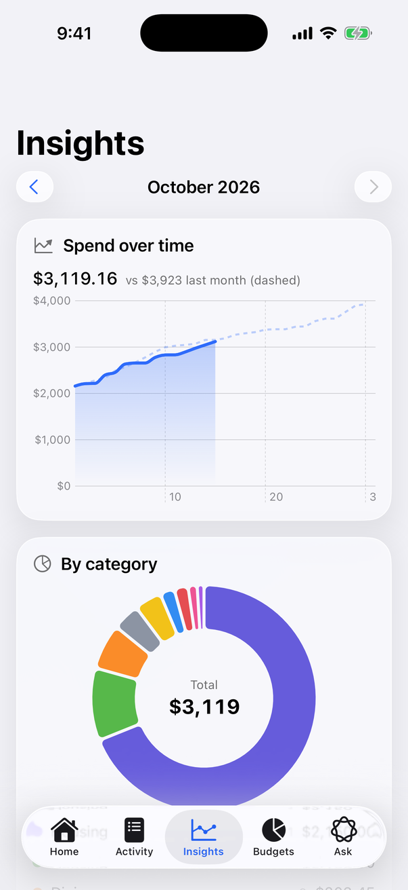
  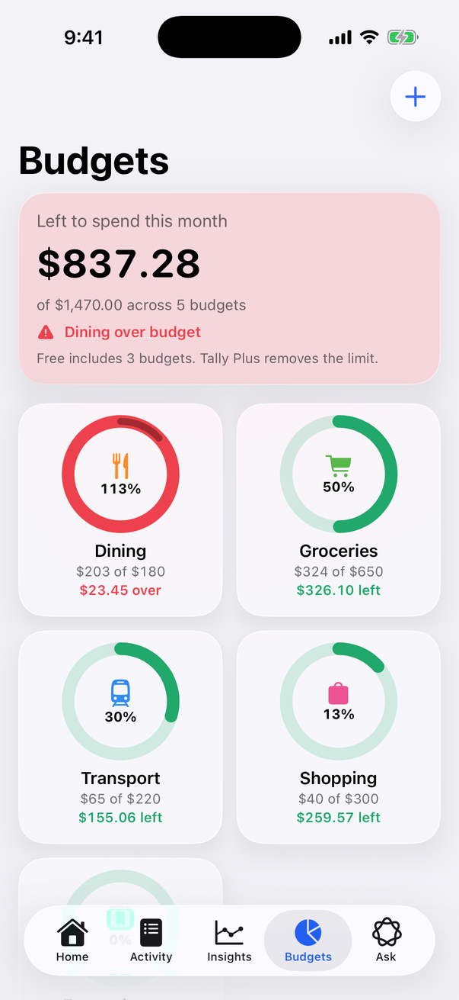
  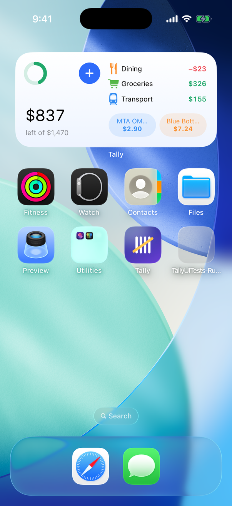
</p>

<p align="center"><sub>Real screenshots from the iOS 26.5 simulator with <code>-demoData</code>. The Ask Tally answer is live output from the on-device model.</sub></p>

## Why

Your finances are the last data you should send to a server for AI. A bank
history says where you live, who you see, what you're treating and what you
can afford. Tally gets the useful part of an AI assistant (plain-English
questions, automatic categories, a monthly summary) from the model Apple ships
on the device, with no account, no backend and no analytics.

The interesting engineering problem is that an on-device model is small. It
writes well and does arithmetic badly. So in Tally the model never touches a
number: it picks a tool, the tool runs tested Swift code, and the app checks
that every figure in the answer came from that code.

## Features

### On-device AI
- **Ask Tally**: a chat backed by `LanguageModelSession` with five typed tools: `spendByCategory`, `compareRanges`, `topPayees`, `findTransactions` and `budgetStatus`. Each answer shows how many figures were verified and has a "How Tally got this" disclosure with every tool call, its arguments and its raw output.
- **Auto-categorise**: `@Generable` guided generation returns a category constrained to Tally's own list plus a 0–100 confidence. It runs after your learned rules and the shipped keyword rules, so it handles the long tail ("TST* LUCKY DUMPLING HOUSE") without overruling a known merchant.
- **Learns from you**: correct a category with "Remember for this payee" and Tally stores a rule that beats the model from then on.
- **Monthly insight**: a two-sentence summary written on device, checked for invented figures, with a deterministic template fallback.
- **Graceful without Apple Intelligence**: the app says why (ineligible device, turned off, still downloading, unsupported language), and rules, charts and budgets keep working.

### Budgets and insights
- Monthly category budgets with progress rings that show overspend as a second lap, and a local notification the first time a budget goes over each month.
- Swift Charts for cumulative spend against last month, category share (tap or drag the ring) and six months of cash flow, all with interactive selection.
- Multiple accounts (cash, bank, card) in any currency, with exchange rates you enter. Tally never fetches rates.
- Recurring transactions that post themselves, idempotently, even after the app was closed for a month.
- CSV import with RFC 4180 parsing, automatic column and date-format detection, European decimals and a line-by-line preview of what will be skipped.

### System integration
- App Intents: **Add Expense**, **How Much Did I Spend** (on a category, for a period) and **Show Budget**, all as App Shortcuts with Siri phrases.
- Transactions and payees are `IndexedEntity` types, so they can be indexed for Spotlight and used in Shortcuts.
- An interactive home-screen widget: budget left this month, the top three budgets and one-tap buttons for your two most frequent small purchases, which log the purchase without opening the app.
- A Control Center control (`ControlWidget`) that opens Tally on the add-expense sheet.

<p align="center">
  
  
  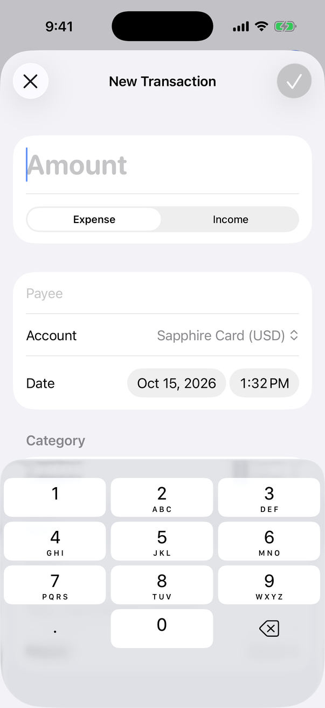
  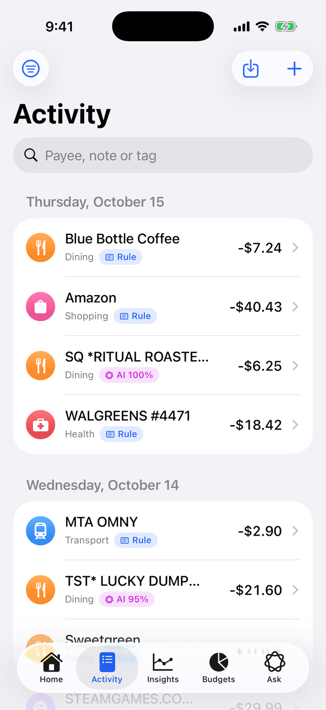
</p>

### Design
- iOS 26 Liquid Glass throughout: the tab bar and toolbars, glass cards, interactive glass on budget tiles and suggestion chips, grouped in `GlassEffectContainer`.
- Account cards finished with a holographic foil sheen from a `[[stitchable]]` Metal shader, applied with `.colorEffect` and driven by the card's scroll position. Reduce Motion pins it.
- Dynamic Type text styles everywhere and `@ScaledMetric` icon sizes, VoiceOver labels on every chart, ring and badge, and light and dark appearances.

<p align="center">
  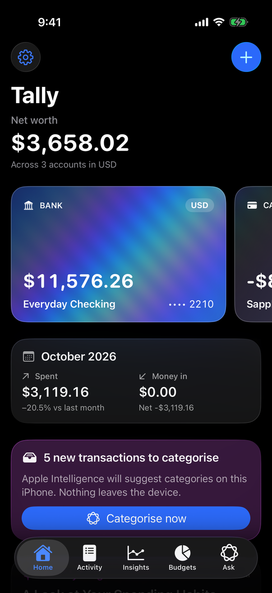
  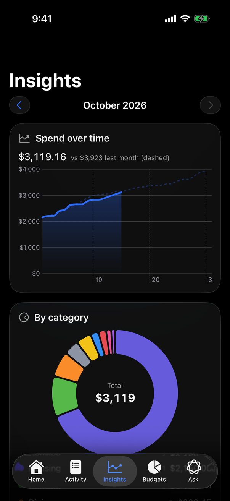
  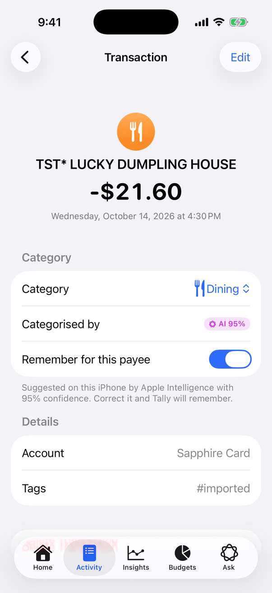
</p>

### Privacy
- All data in SwiftData inside the App Group container on the device. No server, no account, no analytics, no network calls.
- Face ID or passcode app lock (LocalAuthentication), re-armed when the app goes to the background, plus a privacy shield so balances never appear in the app switcher.
- CloudKit sync is supported by the store but off by default behind a build flag, because it needs your team ID (see [ADR-006](docs/ARCHITECTURE.md#adr-006-cloudkit-sync-is-opt-in)).

## Architecture

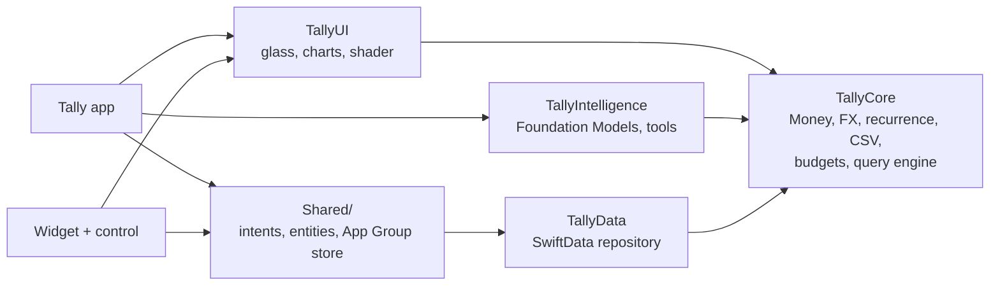

`TallyCore` imports only Foundation, and every number in the app, widget, Siri and Ask Tally comes from its `LedgerQueryEngine`. The app and the widget extension are thin; there are no singletons in domain code, and dependencies are passed in through protocols such as `LedgerRepository` and `TransactionCategorizing`.

How a question flows through the tools:

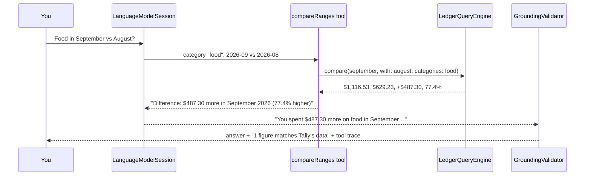

The decisions behind this, and the alternatives turned down, are in [docs/ARCHITECTURE.md](docs/ARCHITECTURE.md).

## How Ask Tally stays honest

1. **The model cannot see the ledger.** It only sees tool definitions. Arguments are `@Generable` structs, and categories are an `anyOf` over Tally's real categories, so a malformed call can't be expressed.
2. **Tools do all the arithmetic.** Totals, differences and percent changes are computed in `TallyCore` (integer minor units, unit tested) and returned as sentences that spell out direction, such as "$487.30 more in September 2026 (77.4% higher)". The instructions tell the model to copy figures, never calculate them, and sampling is greedy.
3. **Every figure is checked.** `GroundingValidator` pulls each amount, count and percentage out of the answer and requires it to appear in some tool output. Years, dates and ordinals are ignored, and a coarser rounding of a real figure is allowed.
4. **One repair, then show the truth.** If a figure has no source, the session gets one follow-up naming it. If the rewrite still fails, the answer is shown with an amber **Unverified** badge, not hidden or silently changed.
5. **The receipts are on screen.** Every answer has the full tool trace.

This is not hypothetical. In an early build the model answered with both monthly totals and then subtracted them itself. The arithmetic happened to be right, but the figure didn't come from a tool, so Tally flagged it (left). Tool descriptions now steer comparisons to `compareRanges`, and the same question produces a fully grounded answer (right).

<p align="center">
  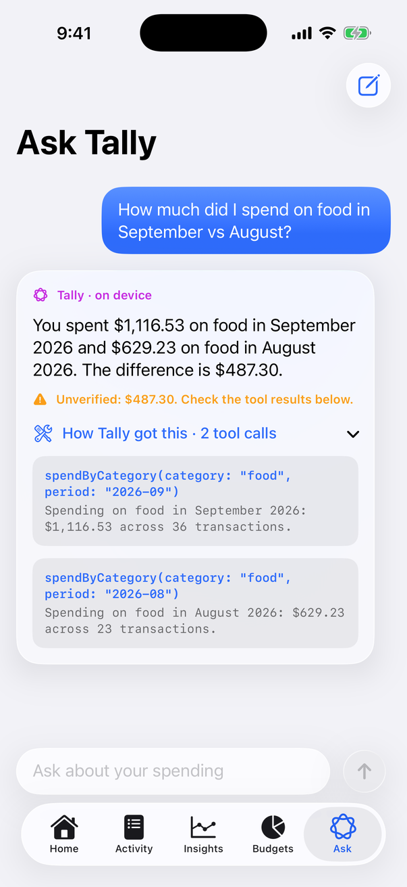
  
</p>

## Tech stack

| Area | Technology |
| --- | --- |
| Language | Swift 6.3, Swift 6 language mode, complete strict concurrency, warnings as errors |
| UI | SwiftUI, Liquid Glass (`glassEffect`, `GlassEffectContainer`, `.glass` button styles), Swift Charts |
| Graphics | Metal `[[stitchable]]` shader via `ShaderLibrary` and `.colorEffect` |
| On-device AI | FoundationModels: `LanguageModelSession`, `Tool`, `@Generable`, `@Guide`, transcripts |
| Persistence | SwiftData in an App Group container behind a `@ModelActor` repository; CloudKit opt-in |
| System | App Intents, App Shortcuts, `IndexedEntity`, WidgetKit (interactive widget, `ControlWidget`), UserNotifications |
| Security | LocalAuthentication |
| Monetisation | StoreKit 2: `SubscriptionStoreView`, `Transaction.currentEntitlements`, `.storekit` configuration |
| Tests | Swift Testing, StoreKitTest, XCUITest |
| Tooling | Xcode 26.6, XcodeGen 2.46, SwiftLint 0.65, GitHub Actions |

## Quick start

Requires Xcode 26.6 and an iOS 26 simulator. Apple Intelligence must be enabled on the Mac for Ask Tally in the simulator.

```sh
brew install xcodegen
xcodegen generate
open Tally.xcodeproj   # run the Tally scheme; it launches with -demoData and the StoreKit configuration
```

The `-demoData` launch argument seeds six months of fictional finances (salary, rent, groceries, subscriptions and a trip to Lisbon) across three accounts in USD and EUR. If the build stops at `Holographic.metal`, install Xcode's Metal component once with `xcodebuild -downloadComponent MetalToolchain`.

## Quality

- **94 Swift Testing tests** across the packages and the app: Money rounding and overflow, FX cross rates, recurrence across DST in both directions and across time zones, CSV edge cases, the exact output of every Ask Tally tool, the grounding validator, categoriser precedence, budget alerts and entitlement rules. A further 3 StoreKitTest cases cover purchase, expiry and refund; they need Xcode's local StoreKit environment, so they are skipped on the command line and in CI.
- **2 UI tests** that add the widget and log a purchase from it, and add the Control Center control and open quick add with it.
- **Zero warnings** under Swift 6 strict concurrency with warnings as errors in every target, and `swiftlint lint --strict` clean.
- **Money is never `Double`.** Integer minor units with ISO 4217 exponents and an explicit, tested rounding policy.
- **CI** on a `macos-26` runner with Xcode 26.6 pinned: lint, package tests, then `xcodegen` and `xcodebuild build test` on an iOS 26.5 simulator.

## Roadmap

- Incremental queries in the repository once ledgers outgrow in-memory snapshots.
- Split transactions and transfers that link both legs.
- Streaming Ask Tally answers with `streamResponse`, keeping the grounding check on the final text.
- A custom adapter for categorisation trained on anonymised descriptor patterns.
- Lock Screen and StandBy widgets, and a Live Activity for a trip budget.
- iPad layout with a sidebar and keyboard shortcuts.

---

Built by [Owais Munawwar](https://github.com/OwaisMunawar). I'm available for React Native, AI and iOS work on [Upwork](https://www.upwork.com/freelancers/owaism11).
