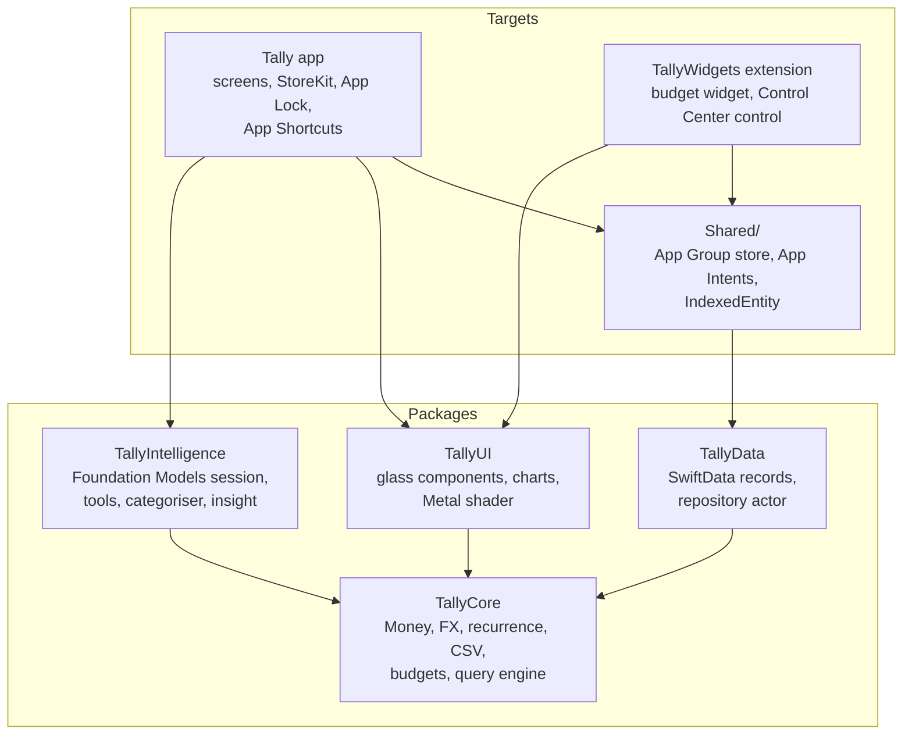
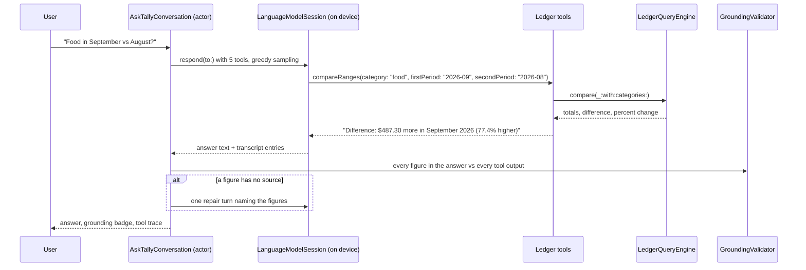

# Architecture

Tally is a SwiftUI app over four local Swift packages. The app target and the
widget extension are thin: they compose packages and present screens. All
business logic, including every number the user sees, lives in `TallyCore`.

`TallyCore` imports only Foundation and has no knowledge of SwiftUI, SwiftData,
StoreKit or Foundation Models, which is why 66 of its tests run in about 20 ms on
the Mac with `swift test`.

## Data flow

1. `LedgerStore` (`@MainActor @Observable`) loads `LedgerData` from a
   `LedgerRepository` and builds a `LedgerQueryEngine` over it.
2. Views read from the engine. Writes go through `LedgerStore`, which saves via
   the repository, rebuilds the engine and tells its observers: the widget
   refresher, the Spotlight indexer and the budget-alert notifier.
3. The widget extension and App Intents open the same SwiftData store in the
   App Group container and build their own engine. Siri, the widget and the app
   therefore compute "how much did I spend on dining" with the same code.

## Ask Tally

---

## Decisions

Each record states the decision, why, and what was rejected.

### ADR-001: On-device Foundation Models instead of a cloud LLM

**Decision.** All language features use Apple's on-device model through the
FoundationModels framework, guarded by `SystemLanguageModel.availability`.

**Why.** Transaction history is about the most sensitive data a phone holds.
On device, there is no server to secure, no data-processing agreement, no
per-token bill and no network dependency. The model is small (a few billion
parameters, around 4K tokens of context), so the design compensates: tools do
the reasoning over data, and guided generation constrains outputs.

**Rejected.** A hosted cloud model would answer more
open-ended questions, but it means shipping the ledger off device or building an
anonymisation layer, plus a backend for keys. A bundled open-weights model via
MLX would avoid the cloud but adds gigabytes to the app and its own update cycle.

**Consequence.** Ask Tally is unavailable on devices without Apple Intelligence.
`AssistantAvailability` explains why in plain words, and everything except chat
keeps working: rules categorise, charts and budgets are model-free, and the
monthly insight falls back to a template.

### ADR-002: Tool calling instead of text-to-SQL

**Decision.** The model sees the ledger only through five typed tools
(`spendByCategory`, `compareRanges`, `topPayees`, `findTransactions`,
`budgetStatus`), each a thin adapter over `LedgerQueryEngine`.

**Why.** Text-to-SQL asks a small model to write correct queries against a
schema, then trusts whatever comes back. Typed tools with `@Generable`
arguments make malformed calls impossible (`category` is an `anyOf` over the
real categories), keep the schema private, and mean every figure was computed by
code that has unit tests. Tools return finished sentences such as
"Difference: $72.00 more in September 2026 (106.7% higher)", so the model copies
rather than computes.

**Honesty check.** `GroundingValidator` extracts every figure from the answer
and requires it to appear in some tool output (a coarser rounding such as
"$1,137" for "$1,137.10" is accepted; finer precision is not). Years, days of
the month and ordinals are ignored. If anything is unverified, the session gets
one repair turn naming the figures; if that still fails, the answer is shown
with an amber "Unverified" badge rather than hidden. The tool trace is always one
tap away.

**Rejected.** Text-to-SQL (above). Stuffing the ledger into the prompt does not
fit a 4K context and invites invented totals. A single generic `query` tool
pushes too much decision-making onto the model.

### ADR-003: SwiftData behind a repository, instead of GRDB or Core Data

**Decision.** SwiftData stores the ledger. A `@ModelActor` repository maps
`@Model` records to plain value types, and nothing outside `TallyData` sees a
`@Model`.

**Why.** SwiftData is first-party, works in the widget extension through an App
Group container, and has a path to CloudKit (ADR-006). The repository boundary
keeps its rough edges (observation quirks, limited predicates, no native
`Decimal`) out of the domain, and lets tests and previews swap in
`InMemoryLedgerRepository`.

**Rejected.** GRDB gives real SQL, faster aggregates and precise migrations,
and would be the choice for a ledger of hundreds of thousands of rows. It costs
a third-party dependency and a hand-built CloudKit story. Core Data is mature but
verbose, and SwiftData sits on top of it anyway.

**Consequence.** Aggregates run in memory over a snapshot. That is
milliseconds for a personal ledger (the demo holds a few hundred transactions), and it
is what makes the engine trivially testable. Incremental queries are on the
roadmap if that stops being true.

### ADR-004: Money as integer minor units with an explicit rounding policy

**Decision.** `Money` is an `Int64` count of minor units plus an ISO 4217
`CurrencyCode`. Amounts enter as `Decimal` and are rounded once with a
`RoundingPolicy` (banker's by default). `Double` appears only in `chartValue`,
for drawing.

**Why.** Binary floating point cannot represent 0.10. Integers make sums exact
and overflow detectable (`addingReportingOverflow`, surfaced as a typed
`MoneyError`). Minor-unit exponents come from a table, so JPY has zero
decimals and KWD has three. Banker's rounding avoids the upward drift half-up
rounding causes across thousands of FX conversions; the policy is a parameter
because receipts usually round half away from zero.

**FX.** Rates are quoted against one base currency and entered by the user.
Cross conversions go through the base with a single rounding at the end. The
query engine converts each transaction once, at load, then sums integers. A
missing rate fails loudly (`FXError.missingRate`) rather than silently dropping
a transaction from totals.

**Rejected.** `Decimal` everywhere works but makes overflow and currency
mismatches easy to ignore. A money library dependency was unnecessary for this
much code.

### ADR-005: Package boundaries

**Decision.** Four packages with one-way dependencies: everything depends on
`TallyCore`; nothing depends on the app.

- `TallyCore`: Foundation only. Domain types, maths, parsing and the query engine.
- `TallyData`: SwiftData, nothing else Apple-UI.
- `TallyIntelligence`: the only place `import FoundationModels` appears.
- `TallyUI`: SwiftUI and Charts components with no knowledge of persistence.

**Why.** The boundaries are enforced by the compiler rather than by
convention, each package builds and tests on its own, and the widget extension
links only what it needs (it never links FoundationModels).

**Rejected.** A single app module with folders: faster to start, but nothing
stops a view from importing SwiftData or a tool from formatting currency its own
way.

### ADR-006: CloudKit sync is opt-in

**Decision.** `TallyStore.makeContainer(location:cloudKit:)` can mirror to the
private iCloud database, but the app passes `BuildFlags.cloudKitSync`, which is
`false` unless the `TALLY_CLOUDKIT` compilation condition is set.

**Why.** CloudKit needs a team ID, an iCloud container and entitlements that
cannot live in a public repo, and the default experience should not need an
account. The schema is already CloudKit-compatible: every attribute has a
default, there are no unique constraints, and rows reference each other by
UUID instead of non-optional relationships.

**To enable.** Set your team in `project.yml`, add
`com.apple.developer.icloud-container-identifiers` and
`com.apple.developer.icloud-services: [CloudKit]` to `App/Tally.entitlements`,
add the Background Modes remote-notification capability, and append
`TALLY_CLOUDKIT` to `SWIFT_ACTIVE_COMPILATION_CONDITIONS`.

### ADR-007: Holographic cards with a stitchable colorEffect shader

**Decision.** Account cards get a foil sheen from a `[[stitchable]]` Metal
function applied with `.colorEffect` inside `.visualEffect`. The band position
comes from the card's frame in its horizontal scroll view, so the foil moves as
the user swipes between cards.

**Why.** `colorEffect` is the cheapest shader stage: per-pixel colour in, colour
out, with no sampling of neighbours, which is all a sheen needs. Driving it from
scroll position makes it deterministic and free of sensors. Under Reduce Motion
the band is pinned.

**Rejected.** `layerEffect` (needs a layer sample, unnecessary here);
CoreMotion tilt (drains battery, does nothing in the simulator, and is
distracting in a finance app); a `TimelineView` animation (constant redraws for
decoration).

## Concurrency

Swift 6 language mode with complete strict concurrency and warnings as errors in
every target.

- Domain types are `Sendable` values.
- `SwiftDataLedgerRepository` is a `@ModelActor`; `InMemoryLedgerRepository` is
  an actor; `AskTallyConversation` is an actor serialising a non-reentrant model
  session.
- UI state (`LedgerStore`, `PlusStore`, `AppLock`, the services) is
  `@MainActor @Observable`.
- `LAContext` is created and used inside a `nonisolated` function so it never
  crosses actors.

## Testing

| Suite | What it pins down |
| --- | --- |
| TallyCore (66) | rounding policies, ISO exponents, overflow, allocation; FX cross rates and round trips; half-open months, period parsing; recurrence across DST in both directions, month-end clamping, leap days, time zones, idempotent posting; RFC 4180 edge cases; bank amount formats; mapping detection; every query behind every tool; budget states and alert de-duplication; entitlement rules; demo data determinism |
| TallyData (5) | full round trip of the demo ledger through SwiftData, provenance, exact decimal rates, typed errors |
| TallyIntelligence (20) | the grounding validator, each tool's exact output, the categoriser's precedence with a scripted model, transcript parsing |
| App (6) | correction learning, recurring posting on load, CSV currency conversion; StoreKit purchase, expiry and refund (opt-in, see CONTRIBUTING) |
| UI (2) | add the widget and log a preset purchase from it; add the Control Center control and open quick add with it |
